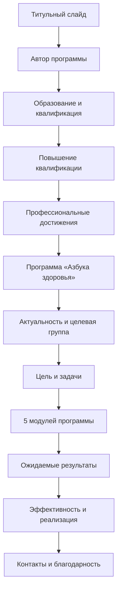

## Презентация: «Азбука здоровья»  
*Авторская программа формирования навыков ЗОЖ у детей с ОВЗ*

---

### Структура презентации (12 слайдов)



---

### Содержание слайдов

#### **Слайд 1. Титульный**
```
АЗБУКА ЗДОРОВЬЯ
Формирование навыков здорового образа жизни 
у детей с ограниченными возможностями здоровья

Автор-составитель:
Судьина Лилия Кенжебаевна
инструктор по адаптивной физической культуре

БУ «Сургутский районный комплексный центр 
социального обслуживания населения»
г.п. Белый Яр, 2023 г.
```

---

#### **Слайд 2. Автор программы**
```
ЛИЛИЯ КЕНЖЕБАЕВНА СУДЬИНА
Инструктор по адаптивной физической культуре

• Работает в отделении социальной реабилитации 
  и абилитации детей с ОВЗ (филиал г.п. Белый Яр)
• Специализация: адаптивная физкультура, 
  коррекция двигательных нарушений, 
  формирование навыков самообслуживания
• Реализует комплексный подход к реабилитации 
  детей с 3 до 18 лет с различными нозологическими 
  формами инвалидности
```

---

#### **Слайд 3. Образование и квалификация**
```
ОБРАЗОВАНИЕ

✓ Высшее профессиональное образование
  Сургутский государственный университет (2006 г.)
  Специальность: «Специалист по адаптивной 
  физической культуре»

✓ Специализация:
  — Адаптивная физическая культура для детей с ОВЗ
  — Ранняя помощь детям-инвалидам
  — Практические приёмы работы с детьми со средней 
    и тяжёлой формой умственной отсталости
```

---

#### **Слайд 4. Повышение квалификации (ключевые направления)**
```
ПРОФЕССИОНАЛЬНОЕ РАЗВИТИЕ

2020–2022 гг. — системное обучение по направлениям:

• Организация деятельности служб ранней помощи
• Комплексная социальная реабилитация детей-инвалидов
• Адаптивная физическая культура для детей с ОВЗ
• Адаптивное скалолазание и современные практики АФК
• Особенности ухода после инсульта, инфаркта, 
  сахарного диабета, двигательных нарушений
• Практические приёмы воспитательной работы 
  с детьми с умственной отсталостью

Организации повышения квалификации:
БУ «Ресурсный центр развития социального обслуживания»,
Благотворительный фонд «Дом Роналда Макдоналда»,
Сургутский государственный университет
```

---

#### **Слайд 5. Профессиональные достижения**
```
НАГРАДЫ И ПРИЗНАНИЕ

✓ Благодарственное письмо 
  БУ «Сургутский районный КЦСОН» (2019)

✓ Благодарственное письмо Главы Сургутского района (2021)

✓ Занесение на Доску почёта «Гордость Учреждения» (2022)

→ Признание экспертизы в области адаптивной физкультуры 
  и социальной реабилитации детей с ОВЗ
```

---

#### **Слайд 6. Программа «Азбука здоровья» — аннотация**
```
ЧТО ТАКОЕ «АЗБУКА ЗДОРОВЬЯ»?

Социально-педагогическая программа 
бессрочного действия для формирования 
навыков здорового образа жизни у детей 
с ограниченными возможностями здоровья 
и детей-инвалидов в возрасте 3–18 лет.

ОСОБЕННОСТЬ:
Комплексный подход с учётом нозологических 
особенностей — педагогический, психологический, 
экологический и социальный аспекты здоровья.

ПРОДОЛЖИТЕЛЬНОСТЬ КУРСА: 28 дней
Ежедневные занятия (15–30 мин) по 5 модулям
```

---

#### **Слайд 7. Актуальность и целевая группа**
```
ПОЧЕМУ ЭТО ВАЖНО?

ДЕТИ С ОВЗ ЧАСТО ИМЕЮТ:
• Нарушения моторики и координации
• Нервно-психические расстройства
• Снижение остроты слуха/зрения, сколиоз
• Нарушения эмоционально-личностного развития
• Зависимость от опеки в самообслуживании

ЦЕЛЕВАЯ ГРУППА:
Несовершеннолетние с ОВЗ и дети-инвалиды 
в возрасте от 3 до 18 лет, проходящие курс 
реабилитации в отделении социальной 
реабилитации и абилитации
```

---

#### **Слайд 8. Цель и задачи программы**
```
ЦЕЛЬ:
Повышение уровня сформированности навыков 
здорового образа жизни у семей, воспитывающих 
детей с ОВЗ и детей-инвалидов

ЗАДАЧИ:
1. Знакомство с основными принципами ЗОЖ
2. Формирование санитарно-гигиенических 
   и социально-бытовых навыков
3. Снижение мышечного и психоэмоционального 
   напряжения
4. Повышение информированности родителей 
   об особенностях развития детей
5. Анализ эффективности реализации программы
```

---

#### **Слайд 9. Пять модулей программы**
```
МОДУЛЬ 1 «Учусь делать сам!»
→ Формирование навыков самообслуживания: 
   умывание, одевание, гигиена

МОДУЛЬ 2 «Давайте поедим»
→ Основы здорового питания, культура поведения за столом, 
   знакомство с витаминами

МОДУЛЬ 3 «Будь здоров!»
→ Адаптивная физическая культура: 
   коррекция, реабилитация, рекреация

МОДУЛЬ 4 «Быть здоровым — здорово!»
→ Спортивно-оздоровительные мероприятия: 
   подвижные игры, эстафеты, весёлые старты

МОДУЛЬ 5 «Мама, расскажи мне, как быть здоровым»
→ Консультации для родителей, совместные мероприятия, 
   вовлечение семьи в процесс реабилитации
```

---

#### **Слайд 10. Ожидаемые результаты**
```
КОЛИЧЕСТВЕННЫЕ ПОКАЗАТЕЛИ (за курс 28 дней):

✓ 5+ детей ознакомлены с принципами ЗОЖ
✓ 60% участников — сформированы базовые 
  гигиенические и бытовые навыки
✓ 65% участников — снижено мышечное и 
  психоэмоциональное напряжение
✓ Родители получили консультации по особенностям 
  развития детей разных нозологических групп

ИНСТРУМЕНТ ОЦЕНКИ:
Карта реабилитации и абилитации детей-инвалидов 
(шкала 0–4 балла по 6 направлениям)
```

---

#### **Слайд 11. Эффективность реализации**
```
РЕСУРСЫ ПРОГРАММЫ:

Кадровые:
— Инструктор по АФК (автор программы)
— Специалист по социальной реабилитации
— Психологи (2 чел.)
— Ассистенты по технической помощи (4 чел.)

Материально-технические:
✓ Оборудованная зона для занятий
✓ Спортивный и реабилитационный инвентарь
✓ Кухня для практических занятий
✓ Аудио-, видеооборудование

ФОРМЫ РАБОТЫ:
индивидуальные, подгрупповые, работа в малых группах
```

---

#### **Слайд 12. Контакты**
```
СПАСИБО ЗА ВНИМАНИЕ!

Бюджетное учреждение ХМАО–Югры
«Сургутский районный комплексный центр 
социального обслуживания населения»

Филиал в г.п. Белый Яр
Отделение социальной реабилитации 
и абилитации детей с ОВЗ

Автор программы:
Судьина Лилия Кенжебаевна
инструктор по адаптивной физической культуре

Официальный сайт учреждения
Группы в соцсетях: ВКонтакте, Одноклассники
```

---

### Рекомендации по оформлению:
- Использовать спокойную цветовую палитру (голубой, зелёный, бежевый) — ассоциация со здоровьем
- На слайдах с модулями добавить иконки: 🧴 (модуль 1), 🥦 (модуль 2), 🏃 (модуль 3), ⚽ (модуль 4), 👨‍👩‍👧 (модуль 5)
- Включить 1–2 фото с занятий (при наличии разрешения) для слайдов 9–10
- Шрифт: чёткий рубленый (например, Arial, Calibri), размер не менее 24 пт для основного текста

Презентация рассчитана на 10–12 минут устного выступления.